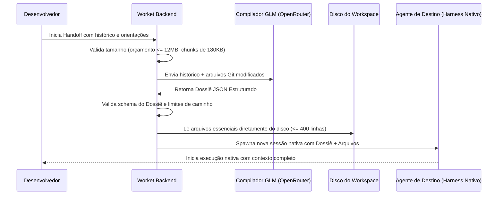

# Worket — Catálogo Completo de Funcionalidades e Recursos

Este documento apresenta a especificação detalhada de **cada componente, controle, mecanismo e funcionalidade** do Worket, descrevendo seu propósito, comportamento e implementação.

---

## Índice

1. [Modos de Trabalho e Espaço de Trabalho](#1-modos-de-trabalho-e-espaço-de-trabalho)
2. [Editor de Código e Visualizadores Especializados](#2-editor-de-código-e-visualizadores-especializados)
3. [Sistema de Concorrência de Arquivos e Proteção de Rascunhos](#3-sistema-de-concorrência-de-arquivos-e-proteção-de-rascunhos)
4. [Explorador de Arquivos e Busca Profunda Universal](#4-explorador-de-arquivos-e-busca-profunda-universal)
5. [Integração de Agentes Nativos (Harnesses Oficiais)](#5-integração-de-agentes-nativos-harnesses-oficiais)
6. [Modo Arena: Comparativo Lado a Lado](#6-modo-arena-comparativo-lado-a-lado)
7. [Motor de Handoff GLM de Contexto](#7-motor-de-handoff-glm-de-contexto)
8. [Painel Git Visual e Geração de Commits por IA](#8-painel-git-visual-e-geração-de-commits-por-ia)
9. [Sistema de Checkpoints e Rollback de Segurança](#9-sistema-de-checkpoints-e-rollback-de-segurança)
10. [Terminal PTY Integrado e Comandos Inteligentes](#10-terminal-pty-integrado-e-comandos-inteligentes)
11. [Preview Web em Tempo Real](#11-preview-web-em-tempo-real)
12. [Auditoria de Consumo, Tokens e Custos em USD](#12-auditoria-de-consumo-tokens-e-custos-em-usd)
13. [Diálogos Próprios do Aplicativo](#13-diálogos-próprios-do-aplicativo)
14. [Sistema de Temas e Personalização Visual](#14-sistema-de-temas-e-personalização-visual)
15. [Arquitetura de Isolamento Desktop e Armazenamento Local](#15-arquitetura-de-isolamento-desktop-e-armazenamento-local)
16. [Tabela de Atalhos de Teclado](#16-tabela-de-atalhos-de-teclado)

---

## 1. Modos de Trabalho e Espaço de Trabalho

O Worket disponibiliza três layouts de interface otimizados no topo da janela, compartilhando o mesmo estado de sessões e rascunhos:

### 1.1. Modo Work (Ambiente de Edição Contínua)
- **Composição:** Árvore de arquivos à esquerda (Explorer), abas de código ao centro (Monaco Editor) e conversa com o agente ativo à direita.
- **Divisórias Dinâmicas:** Três painéis redimensionáveis por arraste do mouse ou pelas setas do teclado (com passos de 10px ou 40px com `Shift`).
- **Recolhimento do Chat:** Um botão de balão na barra superior minimiza o painel do chat para dedicar largura máxima ao editor; um segundo clique o restaura com a geometria lembrada.
- **Comportamento Responsivo:** Em janelas menores (até 740px), o editor se recolhe para manter a conversa legível; em telas intermediárias (~900px), o explorador flutua como camada suspensa.

### 1.2. Modo Chat (Foco em Conversação e Multi-Projetos)
- **Barra Lateral por Agente:** Alterna entre listas de conversas dos diferentes agentes instalados (Hermes / OpenCode).
- **Projetos Dedicados:** Permite fixar múltiplas pastas/projetos na barra lateral sem alterar o diretório principal aberto no Explorer.
- **"Novo chat no projeto":** Cria uma sessão nativa apontando para a raiz daquele projeto específico.
- **Metadados em Tempo Real:** Rodapé com tokens acumulados e custo exato em USD do chat ativo.

### 1.3. Modo Arena (Benchmarking e Comparação Lado a Lado)
- **Painéis Gêmeos:** Exibe duas conversas completas simultaneamente — o painel principal utiliza o agente selecionado e o secundário utiliza o harness alternativo.
- **Sincronização de Sessões:** Permite testar o mesmo prompt contra diferentes modelos ou agentes e avaliar velocidade, raciocínio, uso de ferramentas e qualidade do código gerado.
- **Preservação de Contexto:** Alternar entre Arena, Work e Chat nunca descarta o texto digitado nem recarrega os históricos do disco desnecessariamente.

---

## 2. Editor de Código e Visualizadores Especializados

O Worket utiliza o **Monaco Editor 0.52.0** como motor principal de edição textual, complementado por visualizadores customizados para formatos específicos:

### 2.1. Abas e Gerenciamento de Arquivos Abertos
- **Linha Própria de Abas:** As abas têm uma linha dedicada com largura independente, rolando automaticamente para manter a aba ativa sempre visível.
- **Indicador de Alteração Não Salva:** Exibe um ponto gráfico (`•`) na aba e no explorador para indicar rascunho em memória pendente de gravação.
- **Fechamento Seguro (`Ctrl+W`):** Solicita confirmação caso o arquivo contenha alterações não salvas antes de fechar a aba.
- **Atalhos de Alternância:** Navegação rápida via `Ctrl+Tab` e `Ctrl+Shift+Tab`.

### 2.2. Integração Profunda Editor ⇄ Chat
- **"Seleção → chat" (`Ctrl+Shift+L`):** Copia o trecho de código selecionado no editor e o anexa ao compositor de mensagem do agente com o identificador formal `@caminho/arquivo:linha_inicio-linha_fim`.
- **Inserção Cirúrgica de Código:** O botão "Inserir no editor" disponível em blocos de código gerados pelo agente substitui estritamente a seleção atual do cursor; sem seleção ativa, insere na posição do cursor sem destruir o restante do arquivo.
- **Revisão e Aprovação:** Blocos sugeridos por agentes ficam visualmente marcados no editor até que o desenvolvedor clique em "Aprovar e salvar" ou desfaça a alteração.

### 2.3. Visualizadores Protegidos contra Corrupção
- **Visualizador de Imagens:** Suporte a arquivos `.png`, `.jpg`, `.svg`, etc., com pré-visualização gráfica e botão de anexar diretamente ao chat do agente.
- **Visualizador de SQLite:** Renderiza arquivos `.sqlite` e `.db` em tabela estruturada de leitura com contagem de registros e colunas, desvinculando o editor de texto.
- **Visualizador Binário:** Detecta arquivos executáveis ou binários arbitrários (`.bin`, etc.), exibindo tamanho e metadados.
- **Bloqueio de Gravação Textual (HTTP 415):** Tanto o frontend quanto o backend recusam requisições textuais de salvamento (`Ctrl+S`) para esses visualizadores protegidos, garantindo que nenhum binário seja corrompido por salvamento acidental.

### 2.4. Diff Integrado contra o Git HEAD
- O botão **Diff** abre uma visão comparativa lado a lado entre a versão original do Git HEAD e o estado atual do editor — inclusive alterações que ainda não foram gravadas em disco. Arquivos novos são comparados com um buffer vazio.

---

## 3. Sistema de Concorrência de Arquivos e Proteção de Rascunhos

Para desenvolvedores trabalhando em conjunto com agentes autônomos que também editam arquivos no disco, o Worket implementa um protocolo robusto de concorrência em tempo real:

1. **File Watcher Nativo:** Arquivos abertos são observados em segundo plano.
2. **Atualização Transparente de Arquivos Limpos:** Se o arquivo for modificado no disco por um agente externo e o usuário não tiver alterações locais não salvas, o Monaco é atualizado instantaneamente sem incomodar o desenvolvedor.
3. **Resolução de Conflito em 3 Vias para Rascunhos Sujos:** Se o usuário possui um rascunho em edição e o agente (ou processo externo) alterar o arquivo no disco:
   - O rascunho local é mantido 100% intacto;
   - Uma barra de aviso de conflito surge acima do editor com três opções claras:
     - **Comparar:** Abre o Monaco Diff entre a versão nova do disco e o rascunho da memória;
     - **Usar disco:** Descarta o rascunho e carrega o conteúdo atualizado externamente;
     - **Manter rascunho:** Mantém a versão do usuário como prioritária para gravação.
4. **Proteção de Escrita no Backend (HTTP 409):** Ao salvar, o hash e metadados de modificação são validados; se o arquivo tiver mudado no disco sem conhecimento do editor, a gravação é bloqueada com status `409 Conflict`.

---

## 4. Explorador de Arquivos e Busca Profunda Universal

### 4.1. Árvore de Diretórios
- **Badges de Status Git em Cores:**
  - `M` (Amarelo): Modificado.
  - `U` (Verde): Novo / Não rastreado (*Untracked*).
  - `A` (Verde): Adicionado ao Stage (*Added*).
  - `R` (Azul): Renomeado (*Renamed*).
  - `!` (Vermelho): Conflito de merge ou revisão pendente.
- **Diferenciação de Stage:** Arquivos em stage recebem indicador específico diferenciando-os de arquivos modificados fora do stage.
- **Carregamento Sob Demanda:** Subpastas carregam sob demanda ao expandir, com cache inteligente e invalidação automática em caso de mutações.

### 4.2. Busca Profunda Universal (`Ctrl+K`)
- **Sem Dependência de Expansão:** Localiza arquivos mesmo em subníveis profundos sem exigir que o desenvolvedor tenha expandido as pastas na árvore visual.
- **Motor Híbrido:**
  - Utiliza `ripgrep` (`rg`) de alta velocidade quando disponível no sistema, respeitando regras do `.gitignore`;
  - Possui fallback interno em memória que ignora `.git`, `node_modules` e `vendor` caso o ripgrep não esteja instalado no host.
- **Paleta Unificada:** Permite pesquisar simultaneamente arquivos do workspace, sessões de chat salvas e comandos rápidos.

---

## 5. Integração de Agentes Nativos (Harnesses Oficiais)

O Worket rejeita o padrão comum de "agente simulado" que apenas envia mensagens com um *system prompt* para uma API de chat genérica.

### 5.1. O Conceito de Harness Oficial
Um **Harness** é o aplicativo oficial do agente instalado pelo usuário:
- As credenciais pertencem ao agente (chaves da Anthropic, OpenAI, Google, etc. ficam salvas nos arquivos de configuração do próprio agente);
- A memória de longo prazo, ferramentas nativas de execução de terminal, leitura e escrita de arquivos são executadas pelo motor nativo;
- O Worket conecta-se ao processo via IPC ou loopback restrito a `127.0.0.1`.

### 5.2. Harness Hermes
- **Backend Oficial:** O Worket inicializa o daemon oficial `hermes serve --isolated --host 127.0.0.1`.
- **Protocolo:** Comunicação assíncrona bidirecional via JSON-RPC sobre WebSocket (`/api/ws`).
- **Autenticação:** Chave de sessão efêmera gerada aleatoriamente por processo (`randomBytes(32)`).
- **Recursos:** Acompanhamento de raciocínio profundo (*chain-of-thought*), parâmetros de pensamento (*budget*), ferramentas nativas e compactação de histórico com preservação da raiz da sessão.

### 5.3. Harness OpenCode
- **Backend Oficial:** Conecta-se à API local oficial instalada em `/api/session/...`.
- **Protocolo:** Requisições REST autenticadas com assinatura de fluxo de eventos SSE (`/api/event`).
- **Recursos:** Suporte a variantes declaradas de modelos, anexos nativos, inspeção de erros nativos (`data.error`) com recuperação posterior preservada no histórico.

### 5.4. Inspetor de Atividade e Chamadas de Ferramentas
- Bloco colapsável **"Trabalhou por Xs"** para cada turno de resposta.
- Revela cada ferramenta executada (ex: `read`, `write`, `bash`), o parâmetro JSON completo de entrada e a resposta devolvida pelo sistema operacional.
- Exibe mensagens intermediárias e subagentes vinculados à conversa mãe.

### 5.5. Portão de Permissões Interativo
- Banner em destaque quando um agente solicita permissão para executar uma ação sensível (ex: ler arquivos confidenciais ou executar comandos no shell).
- Botões claros de **"Permitir uma vez"** ou **"Recusar"**, suspendendo o fluxo do agente até a decisão humana.

---

## 6. Modo Arena: Comparativo Lado a Lado

O Modo Arena transforma o Worket em uma plataforma de testes comparativos para IA:

1. **Dois Chats Ativos Simultaneamente:** Painel da esquerda com o agente A (ex: OpenCode) e painel da direita com o agente B (ex: Hermes).
2. **Troca Rápida de Sessões:** Seletores individuais por coluna para inspecionar e parear qualquer sessão do histórico.
3. **Avaliação Prática de Modelos:** Permite ao desenvolvedor enviar o mesmo problema de arquitetura para ambos os agentes e comparar:
   - A estratégia de raciocínio de cada modelo;
   - As ferramentas acionadas e comandos propostos;
   - O consumo final de tokens e custo associado;
   - A qualidade do código produzido.

---

## 7. Motor de Handoff GLM de Contexto

Quando uma conversa com um agente atinge seu limite de contexto ou quando se deseja transferir o trabalho para um agente especializado em outra tarefa, o Worket oferece o **Handoff GLM**:

### 7.1. Esquema do Dossiê
O GLM compila o histórico e retorna um JSON rigorosamente validado contendo:
- `objetivo_atual` (string): Meta técnica principal em andamento.
- `decisoes_tecnicas` (string[]): Lista de decisões de arquitetura e tecnologia adotadas.
- `arquivos_essenciais` (string[]): Arquivos-chave lidos integralmente do disco pelo Worket.
- `arquivos_referencia` ({path, descricao}[]): Arquivos longos ou secundários para leitura sob demanda.
- `proxima_tarefa` (string): O primeiro passo imediato a ser executado pelo novo agente.

### 7.2. Regras de Segurança do Dossiê
- Bloqueio rigoroso de caminhos fora do workspace e ataques por links simbólicos (`realpath`).
- Arquivos com mais de 400 linhas, maiores que 2 MB ou contendo bytes nulos são automaticamente rebaixados para arquivos de referência.
- Divisão em chunks para históricos longos, recusando mensagens gigantes com explicação explícita ao usuário (sem truncamento silencioso de dados).

---

## 8. Painel Git Visual e Geração de Commits por IA

O Worket possui uma suíte Git visual completa acoplada à barra de ferramentas:

### 8.1. Operações Visuais
- **Stage e Unstage:** Adição e remoção de arquivos no índice com 1 clique.
- **Descarte Seguro:** Botão de descarte com diálogo de confirmação explícita (`git restore` ou remoção de arquivo untracked).
- **Gerenciamento de Branches:** Seletor de branches com troca rápida e criação de novas branches via diálogo nativo (`git switch -c`).
- **Push com Upstream:** Envio direto para o repositório remoto com configuração automática de upstream.

### 8.2. Geração de Commit Semântico via IA
- Analisa o `git diff --cached` dos arquivos que estão no stage.
- Envia o diff via OpenRouter com prompt focado em títulos imperativos curtos em português.
- **Segurança Anti-Injeção:** O diff é enviado estritamente como *dados estruturados* e o modelo é instruído a ignorar quaisquer diretivas ou instruções maliciosas contidas em comentários do código.

---

## 9. Sistema de Checkpoints e Rollback de Segurança

Antes que qualquer agente execute comandos que possam alterar arquivos no repositório, o Worket ativa sua camada de segurança:

1. **Snapshot Pré-Execução:** A classe `Checkpoints` captura uma árvore Git temporária sem modificar a branch atual (`refs/worket/checkpoints/<id>/before`).
2. **Snapshot Pós-Execução:** Ao término do turno do agente, um snapshot `after` é gravado.
3. **Rollback de 1 Clique:** Caso o agente tenha gerado código incorreto, quebrado testes ou apagado dados, o desenvolvedor clica em desfazer para restaurar o estado exato de antes daquele turno com confirmação.
4. **Isolamento de Conflitos:** Se o repositório já contiver conflitos de merge não resolvidos, a execução do agente é bloqueada até que o desenvolvedor resolva a situação.

---

## 10. Terminal PTY Integrado e Comandos Inteligentes

A gaveta retrátil inferior oferece um terminal Linux completo:

- **Motor PTY Real:** Alimentado por `node-pty` e `@xterm/xterm` com addon `@xterm/addon-fit`.
- **Até 8 Terminais Concorrentes:** Abas de terminais independentes executando dentro do diretório do projeto.
- **Detecção Automática de Comandos:**
  - Varre o `package.json` em projetos Node e lista todos os scripts (`npm run ...`, `yarn`, `pnpm` ou `bun`);
  - Detecta alvos de compilação em `Makefile`;
  - Disponibiliza um seletor de execução rápida com 1 clique.
- **Shell Integration:** Integração com bashrc próprio (`terminal-bashrc.sh`) para rastrear o comando em execução e código de saída.

---

## 11. Preview Web em Tempo Real

- **Aba de Preview Dedicada:** Permite testar aplicações web e páginas HTML locais diretamente ao lado do editor e do chat.
- **Detecção de Visibilidade Inteligente:** O iframe do preview calcula ancestrais ocultos e sobreposições de menus para não consumir recursos gráficos quando estiver encoberto.
- **Isolamento Seguro:** Roda em processo de visualização protegido contra poluição do DOM da aplicação desktop.

---

## 12. Auditoria de Consumo, Tokens e Custos em USD

- **Telemetria Transparente:** Exibe o total de tokens de entrada e saída e o custo exato em dólares em tempo real.
- **Diferenciação Visual:** Distingue valores confirmados pelos relatórios oficiais dos agentes de valores estimados ou não informados.
- **Zero Invenção de Dados:** Falhas de execução não recebem registros artificiais de custo ou sucesso.

---

## 13. Diálogos Próprios do Aplicativo

Substituição completa das caixas de diálogo síncronas do navegador (`window.prompt`, `window.confirm`) por diálogos estilizados em HTML integrados ao tema:

- Suporte completo a navegação por teclado (`Tab`, `Enter` para confirmar, `Escape` para fechar).
- Utilizados na criação de arquivos, pastas, branches, renomeação, duplicação e confirmação de exclusões e descartes Git.

---

## 14. Sistema de Temas e Personalização Visual

O Worket oferece duas gerações visuais completas, selecionáveis em **Configurações → Aparência**:

### 14.1. V2 · Explorer (Padrão)
- **Design Moderno:** Fundo preto profundo, caixas com cantos arredondados, divisórias discretas e ícones de pastas em tom amarelo característico.
- **Cápsula de Projeto:** Barra superior com identificação visual elegante do projeto ativo.
- **Alto Foco:** Redução de poluição visual na alternância de modos e terminais.

### 14.2. V1 · Original (Paletas Escuras Clássicas)
Conserva a estrutura visual clássica e permite alternar entre 5 paletas customizadas:
1. **Carbono (Padrão V1):** Fundo grafite profundo com alto contraste para longas sessões de código.
2. **Grafite Azulado:** Tonalidade fria inspirada em ambientes de engenharia de dados.
3. **Carvão:** Preto fosco minimalista para redução de emissão de luz.
4. **Fusco:** Tonalidade terrosa suave com baixo cansaço visual.
5. **Ametista:** Acentos roxos elegantes que harmonizam com o tema oficial do agente Hermes.

*Ambos os modos preservam as cores de assinatura dos harnesses: roxo violeta para Hermes e azul oceano para OpenCode.*

---

## 15. Arquitetura de Isolamento Desktop e Armazenamento Local

- **Segurança Electron:** Janela operando com `contextIsolation: true`, `nodeIntegration: false` e sandbox nativo ativado.
- **Protocolo worket://app:** Garante uma origem HTTP/HTTPS estável para o renderizador sem expor o sistema de arquivos local a links de terceiros.
- **Armazenamento de Dados:** Configurações e metadados locais ficam armazenados em SQLite consistente em `~/.config/Worket/data/workbench.db`.
- **Compatibilidade e Migração Suave:** Reutiliza automaticamente bancos e preferências de versões anteriores no local sem risco de perda de dados.
- **Migração Confiável:** Suporte a importação via snapshot consistente (`worket --import-data <arquivo.db>`) com validação de integridade `PRAGMA integrity_check`.

---

## 16. Tabela de Atalhos de Teclado

| Atalho | Ação |
| :--- | :--- |
| `Ctrl+K` ou `⌘K` | Abrir busca profunda universal (arquivos, pastas e sessões). |
| `Ctrl+B` ou `⌘B` | Alternar visibilidade da barra lateral (Explorer / Sessões). |
| `Ctrl+S` ou `⌘S` | Salvar o arquivo ativo no editor (protegido contra binários/SQLite). |
| `Ctrl+W` ou `⌘W` | Fechar aba ativa (com confirmação se modificada). |
| `Ctrl+Tab` | Alternar para a próxima aba do editor. |
| `Ctrl+Shift+Tab` | Alternar para a aba anterior do editor. |
| `Ctrl+Shift+L` | Enviar o trecho de código selecionado para o compositor do chat (`@arquivo:L1-L2`). |
| `Enter` | Enviar mensagem no chat. |
| `Shift+Enter` | Inserir quebra de linha no compositor do chat. |
| `Setas` nas divisórias | Ajustar tamanho do painel em passos de 10px. |
| `Shift + Setas` | Ajustar tamanho do painel em passos de 40px. |
| `Home` ou duplo-clique | Restaurar proporção padrão dos painéis. |
| `Escape` | Fechar diálogos modais, menus suspensos ou busca profunda. |

---

*Worket — Engenharia de software unificada, ágil e focada em inteligência artificial.*

