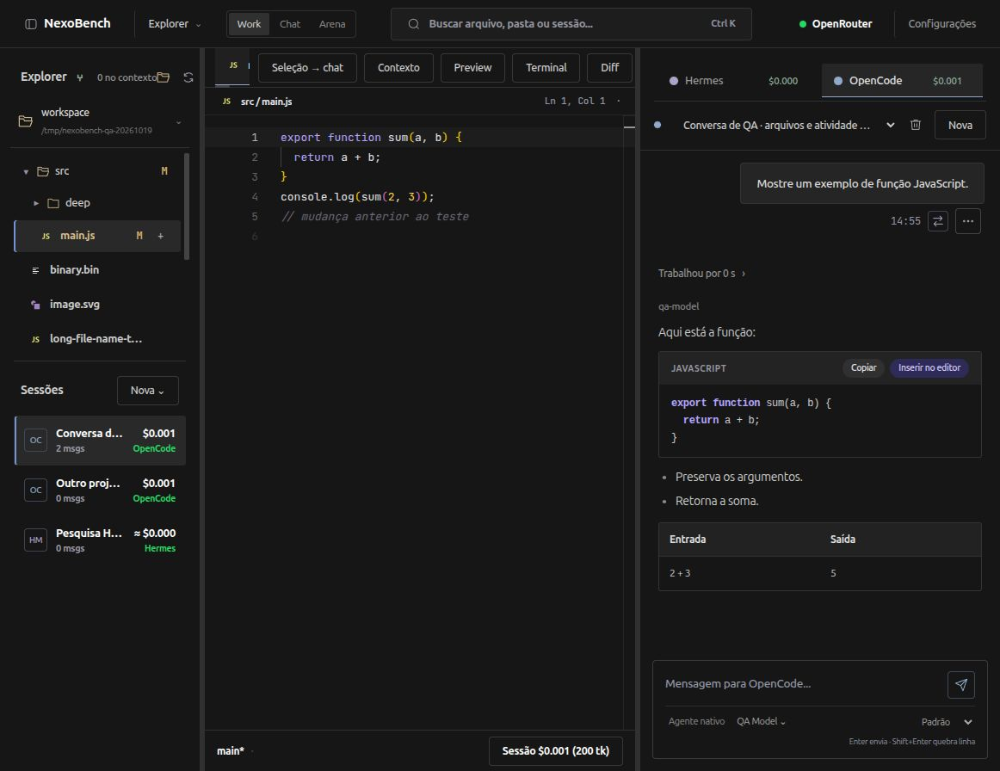
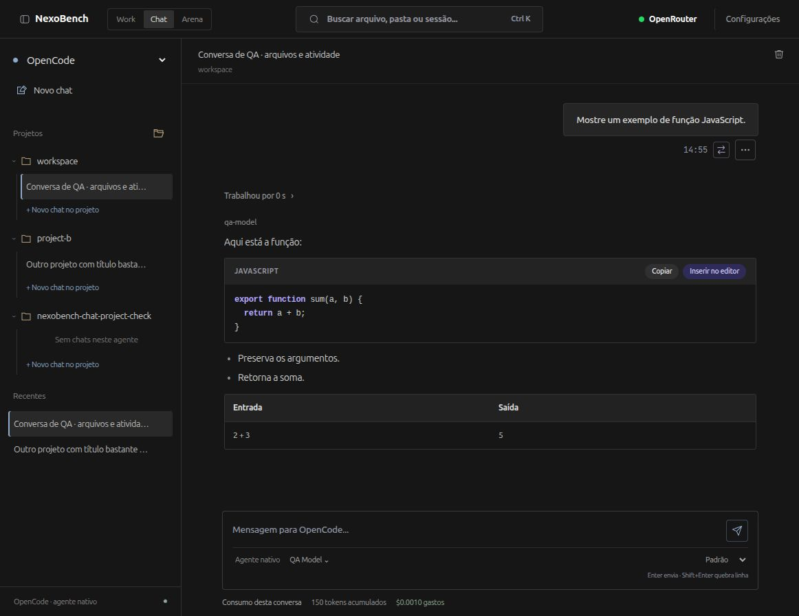
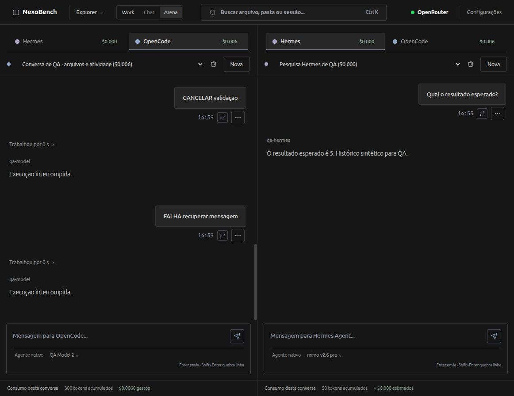
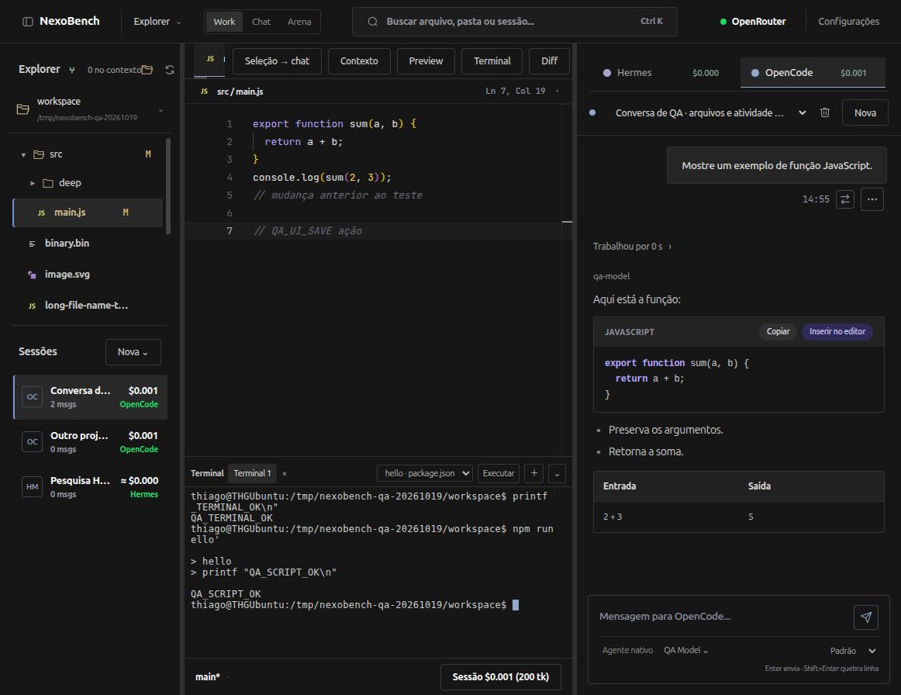
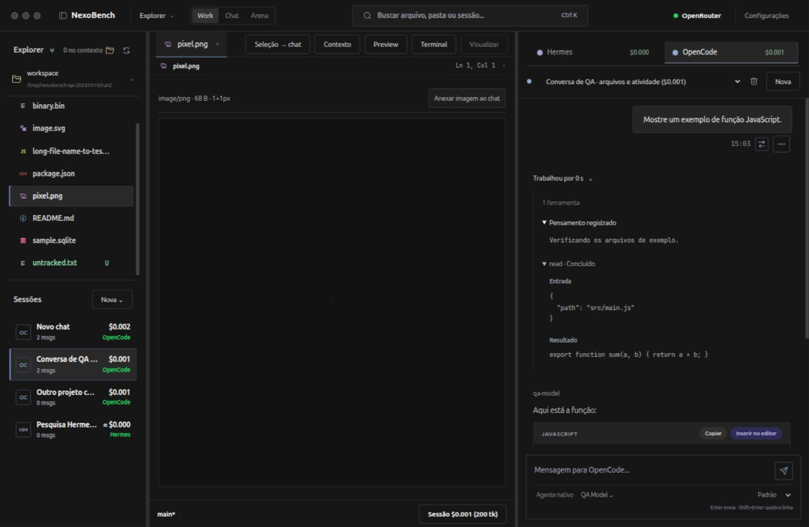
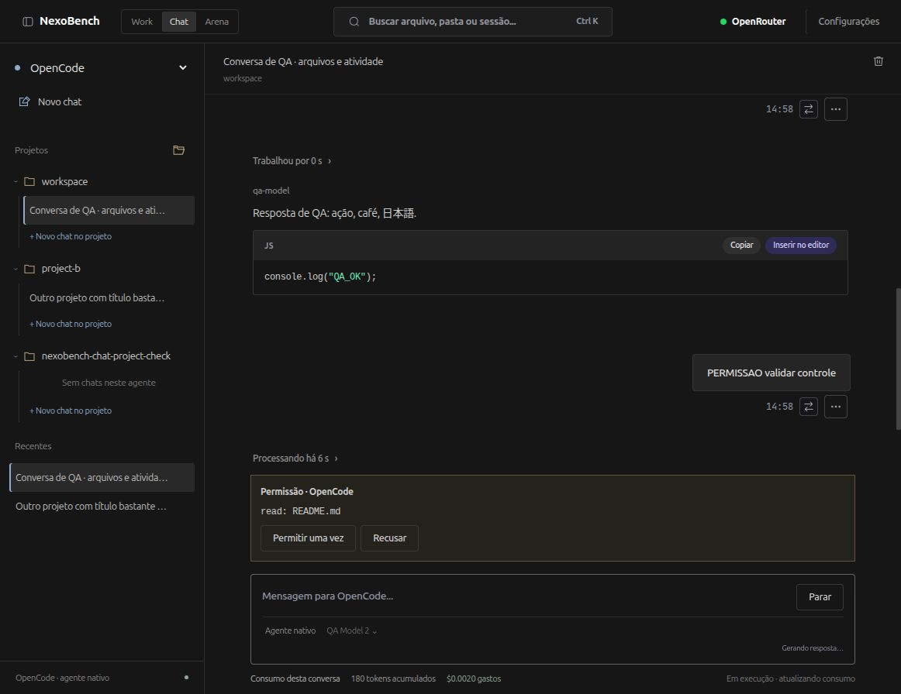

# NexoBench ⚡ Desktop Workbench Showcase

<div align="center">


### *All-in-one desktop workbench: editor, chats, terminal, Git visual e preview com harnesses nativos separados.*

[](https://www.electronjs.org/)
[](https://nodejs.org/)
[](https://microsoft.github.io/monaco-editor/)
[](#qualidade-e-testes)
[](#harnesses-nativos-sem-simulação)
[](#sobre-este-showcase)

**[Visão Geral](#visão-geral)** • **[Demonstração Visual](#demonstração-visual)** • **[Funcionalidades](#principais-funcionalidades)** • **[Arquitetura](#arquitetura-do-sistema)** • **[Segurança](#segurança-e-integridade)** • **[Documentação Completa](#documentação-técnica)**

</div>

---

## 🌟 Visão Geral

O **NexoBench** é um ambiente de desenvolvimento integrado (Workbench) para desktop focado na nova era do desenvolvimento assistido por inteligência artificial. Ele unifica em um único aplicativo de alto desempenho:
1. **Editor de Código Profissional** (Monaco Editor com syntax highlighting e atalhos de alto padrão);
2. **Ambiente Multi-Agente com Execução Real** (Harnesses oficiais do **Hermes** e **OpenCode**, com **Claude Code**, **Antigravity** e **Codex** no roteiro);
3. **Arena de Comparação Lado a Lado** (Permite confrontar dois agentes simultaneamente na mesma tarefa);
4. **Terminal PTY Integrado** (Até 8 terminais com detecção automática de scripts e shell integration);
5. **Painel Git Visual com IA e Checkpoints** (Controle de versão completo, checkpoints antes de execuções de agentes e geração semântica de commits);
6. **Mecanismo de Handoff GLM de Contexto** (Transplante estruturado de contexto e memória entre agentes sem perda de decisões técnicas).

> 💎 **Princípio Central: Sem Simulação de Agentes.**  
> O NexoBench **não finge ser um agente** através de prompts superficiais. Toda conversa, execução de ferramentas (*tool calling*), políticas de permissão, memória e compactação rodam exclusivamente no **harness oficial nativo** (daemons locais via JSON-RPC/WebSocket e APIs HTTP/EventSource oficiais). O OpenRouter direto é estritamente restrito a duas funções declaradas: o compilador de contexto do Handoff GLM e o gerador de mensagens de commit.

---

## 📸 Demonstração Visual

### 1. Modo Work: O Workspace Completo
O modo principal unifica a árvore de arquivos com status Git em tempo real, abas do Monaco Editor com diff visual contra o Git HEAD, e a conversa ativa com o agente.



### 2. Modo Chat: Foco Amplo e Gestão de Múltiplos Projetos
Layout de conversa expandida com histórico agrupado por projeto e agente, rastreamento de custos em USD e tokens acumulados por sessão.



### 3. Modo Arena: Comparação Direta Agente vs Agente
Coloca dois agentes frente a frente (por exemplo, Hermes e OpenCode) para comparar respostas, velocidade de raciocínio, consumo de tokens e saídas de ferramentas.



### 4. Terminal PTY Integrado e Comandos Rápidos
Gaveta retrátil de terminal multiprocesso baseada em `node-pty` e `@xterm/xterm`, com detecção inteligente de scripts do `package.json` e alvos de `Makefile`.



### 5. Atividade e Raciocínio Profundo do Agente
Inspetor detalhado que exibe o tempo de processamento ("Trabalhou por Xs"), pensamentos internos do agente (*chain of thought*), chamadas de ferramentas e payloads completos de entrada e saída.



### 6. Barreira de Permissões e Segurança de Execução
Nenhum agente executa comandos arbitrários ou acessa arquivos sem autorização explícita do desenvolvedor via banner nativo de aprovação.



---

## 🚀 Principais Funcionalidades

| Categoria | Funcionalidade | Descrição |
| :--- | :--- | :--- |
| **Workspace & Modos** | **Modo Work** | Editor Monaco + Chat + Explorer + Terminal em visão contínua. |
| | **Modo Chat** | Interface ampla focada em diálogo, projetos isolados e catálogo de sessões. |
| | **Modo Arena** | Execução paralela e comparativa entre dois harnesses com sincronia de sessões. |
| **Editor & Arquivos** | **Monaco Editor** | Editor profissional com fontes JetBrains Mono e Plus Jakarta Sans. |
| | **Visualizadores Protegidos** | Visualizadores seguros para Imagens, SQLite e Binários (bloqueio de escrita textual com HTTP 415 para evitar corrupção). |
| | **Gestão de Concorrência** | Observador de arquivos em disco que protege rascunhos sujos contra sobrescrita acidental e oferece resolução de conflito em 3 vias. |
| | **Seleção → Chat** | Envia trecho selecionado para a conversa formatado com `@arquivo:L1-L25` (`Ctrl+Shift+L`). |
| | **Diff contra HEAD** | Comparação em tempo real do arquivo aberto (mesmo não salvo) com o Git HEAD. |
| **Agentes & IA** | **Harnesses Nativos** | Integração via daemon oficial local com **Hermes** (JSON-RPC/WS) e **OpenCode** (REST/SSE). |
| | **Raciocínio & Ferramentas** | Exibição de raciocínio (*thought process*), ferramentas e subagentes encadeados. |
| | **Handoff GLM de Contexto** | Compilador inteligente de dossiê para migrar tarefas de um agente para outro sem perda de contexto. |
| | **Controle de Gastos** | Auditoria transparente de tokens consumidos e custos em dólar por sessão e agente. |
| **Git & Versionamento**| **Git Visual Completo** | Stage, unstage, descarte com confirmação, troca e criação de branches. |
| | **Checkpoints de Segurança** | Snapshot automático da árvore Git antes de cada execução de agente com rollback de 1 clique. |
| | **Commit Semântico via IA** | Geração automática de commit baseada no diff staged, tratando código estritamente como dados (proteção contra prompt injection). |
| **Produtividade** | **Busca Profunda (`Ctrl+K`)** | Localizador universal de arquivos e sessões sem depender de expansão da árvore. |
| | **Terminal Multi-Sessão** | Até 8 instâncias PTY simultâneas com integração de shell. |
| | **Temas Escuros Nativos** | 5 paletas refinadas: *Carbono (padrão)*, *Grafite azulado*, *Carvão*, *Fusco* e *Ametista*. |

---

## 🏗 Arquitetura do Sistema

O NexoBench adota uma arquitetura em camadas de alto isolamento, projetada para estabilidade, performance e segurança:


Para uma análise técnica aprofundada de classes, endpoints, ciclo de vida e diagramas de sequência, consulte o [ARCHITECTURE.md](ARCHITECTURE.md).

---

## 🛡️ Segurança e Integridade

1. **Isolamento de Origem:** A janela Electron utiliza isolamento total de contexto (`contextIsolation: true`, `nodeIntegration: false`, `sandbox: true`). A aplicação é servida através do protocolo interno seguro `nexobench://app`.
2. **Serviço Local com Token Efêmero:** O backend sobe em porta dinâmica em loopback (`127.0.0.1`), protegido por chave de autenticação privada gerada por sessão e injetada pelo processo principal do Electron.
3. **Proteção Contra Corrupção de Arquivos:** Visualizadores de imagens, bancos SQLite e arquivos binários bloqueiam salvamentos textuais tanto no cliente quanto no backend (retornando `HTTP 415 Unsupported Media Type`), impedindo a corrupção inadvertida de arquivos binários por atalhos como `Ctrl+S`.
4. **Proteção Contra Sobrescrita Concorrente:** Ao salvar arquivos, o NexoBench verifica a versão do disco contra o estado inicial. Se um arquivo for alterado externamente enquanto havia um rascunho em edição, o aplicativo impede a perda de dados e exibe opções de resolução em 3 vias.
5. **Mitigação de Prompt Injection:** Diff do Git e instruções contidas no código são tratados rigorosamente como dados nas chamadas ao OpenRouter para geração de commits e compilação de dossiês.

---

## 🧪 Qualidade e Testes

A base de código conta com uma suíte de testes automatizados rigorosa:

- **70/70 testes passando** (zero falhas e zero testes ignorados).
- Compatibilidade dupla validada: testada em **Node.js 22.23.2** nativo e no **Node.js 24.22.0** embutido no Electron 44.9.0.
- Cobertura completa de:
  - Proteção de escrita em visualizadores binários/SQLite (conferência de SHA-256 antes e depois);
  - Desvinculação segura de modelos do Monaco e visualizadores;
  - Integridade da árvore de arquivos e busca profunda;
  - Roteamento e streaming multibyte UTF-8;
  - Recuperação de falhas sintéticas e apresentação no histórico;
  - Checkpoints Git, isolamento de diretórios e rollback.

---

## 📚 Documentação Técnica

Explore os guias detalhados criados para este showcase:

- 📖 **[Catálogo Completo de Funcionalidades (FEATURES.md)](FEATURES.md)**: Detalhamento minucioso de cada controle, atalho de teclado, fluxo de trabalho e recursos.
- 📐 **[Documento de Arquitetura (ARCHITECTURE.md)](ARCHITECTURE.md)**: Design de software, adaptadores de harness, IPC, protocolo e diagrama de estados.
- 🛡️ **[Relatório de QA e Segurança (QA-AND-SECURITY.md)](QA-AND-SECURITY.md)**: Auditoria de qualidade, matriz de testes e preservação de dados.
- 🗺️ **[Roteiro de Novos Harnesses (ROADMAP.md)](ROADMAP.md)**: Especificação para Claude Code, Antigravity e Codex.
- 🌐 **[Showcase Web Interativo (docs/index.html)](docs/index.html)**: Demonstração interativa desenvolvida para navegação visual e GitHub Pages.

---

## 💻 Como Executar o Projeto Original

O repositório oficial do projeto está disponível em:  
🔗 **[github.com/thgyuji/nexobench](https://github.com/thgyuji/nexobench)**

### Pré-requisitos
- Node.js >= 22.16.0
- npm e Git
- Linux x64 (Ubuntu/Debian recomendado)
- Agentes oficiais Hermes ou OpenCode instalados localmente

### Comandos de Desenvolvimento
```bash
# Instalar dependências
npm ci

# Compilar assets e Tailwind CSS
npm run build

# Executar suíte de testes (70 testes)
npm test

# Iniciar aplicativo Desktop no Electron
npm run desktop

# Alternativa: Iniciar versão Web no navegador
npm run web
```

### Pacotes de Distribuição Linux
```bash
# Gerar instaladores .deb e .AppImage para Linux
npm run package:linux
```
Os executáveis empacotados são gerados no diretório `dist/`:
- `NexoBench-0.2.2-amd64.deb`
- `NexoBench-0.2.2-x86_64.AppImage`

---

<div align="center">

Desenvolvido com foco em robustez, respeito aos dados locais e produtividade real para desenvolvedores.

**NexoBench** • *The AI Developer's Workbench*

</div>
