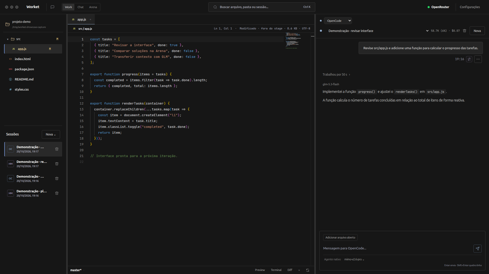
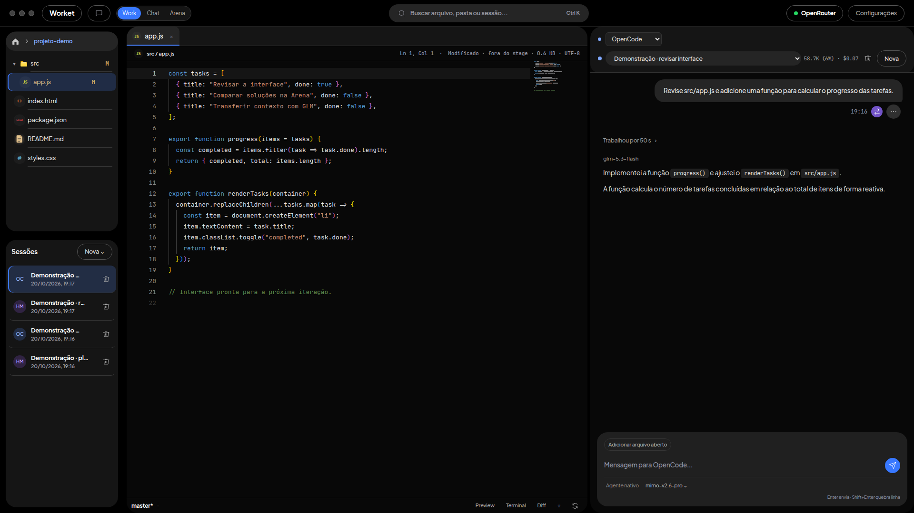
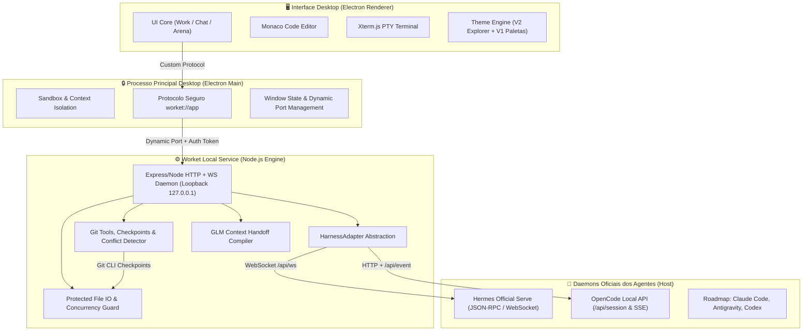

# Worket ⚡ Desktop Workbench Showcase

### *All-in-one desktop workbench: editor, chats, terminal, Git visual e preview com harnesses nativos separados.*

**[Visão Geral](#visão-geral)** • **[Demonstração Visual](#demonstração-visual)** • **[Funcionalidades](#principais-funcionalidades)** • **[Arquitetura](#arquitetura-do-sistema)** • **[Segurança](#segurança-e-integridade)** • **[Documentação Completa](#documentação-técnica)**

---

## 🌟 Visão Geral

O **Worket** é um ambiente de desenvolvimento integrado (Workbench) para desktop focado na nova era do desenvolvimento assistido por inteligência artificial. Ele unifica em um único aplicativo de alto desempenho:
1. **Editor de Código Profissional** (Monaco Editor com syntax highlighting e atalhos de alto padrão);
2. **Ambiente Multi-Agente com Execução Real** (Harnesses oficiais do **Hermes** e **OpenCode**, com **Claude Code**, **Antigravity** e **Codex** no roteiro);
3. **Arena de Comparação Lado a Lado** (Permite confrontar dois agentes simultaneamente na mesma tarefa);
4. **Terminal PTY Integrado** (Até 8 terminais com detecção automática de scripts e shell integration);
5. **Painel Git Visual com IA e Checkpoints** (Controle de versão completo, checkpoints antes de execuções de agentes e geração semântica de commits);
6. **Mecanismo de Handoff GLM de Contexto** (Compilação estruturada do objetivo, decisões técnicas, arquivos relevantes e próxima tarefa para outro chat nativo).

> **Harnesses separados, interface compartilhada.** Hermes e OpenCode executam em processos e sessões independentes, com ferramentas, credenciais, permissões, memória e compactação próprias. Na Arena, os dois painéis mantêm seus contextos separados.
>
> **O GLM faz a ponte quando você pede um handoff.** Ele compila o histórico em um dossiê com objetivo, decisões técnicas, arquivos essenciais e próxima tarefa. O Worket valida o dossiê, lê os arquivos atuais do disco e abre um novo chat nativo no harness de destino. Isso transfere contexto explicitamente; não funde as memórias dos agentes. O OpenRouter direto também é usado para sugerir mensagens de commit.

---

## 📸 Demonstração Visual

**[Abrir o showcase interativo](https://thgyuji.github.io/worket-showcase/)** — escolha **Tema 1 · Original** ou **Tema 2 · Solid** e navegue por Work, Chat, Arena, Terminal, Git e Busca. A escolha do tema é mantida ao trocar de tela.

Capturas atualizadas do Worket **0.3.2**, em um projeto de demonstração sem histórico pessoal. Os textos no compositor são rascunhos; não foi executada inferência para produzir as imagens.

### Tema 1 · Original

### Tema 2 · Solid

---

## 🚀 Principais Funcionalidades

| Categoria | Funcionalidade | Descrição |
| :--- | :--- | :--- |
| **Workspace & Modos** | **Modo Work** | Editor Monaco + Chat + Explorer + Terminal em visão contínua. |
| | **Modo Chat** | Interface ampla focada em diálogo, projetos isolados e catálogo de sessões. |
| | **Modo Arena** | Execução paralela e comparativa entre dois harnesses com sincronia de sessões. |
| **Editor & Arquivos** | **Monaco Editor** | Editor profissional com fontes JetBrains Mono e Plus Jakarta Sans. |
| | **Visualizadores Protegidos** | Visualizadores seguros para Imagens, SQLite e Binários (bloqueio de escrita textual com HTTP 415 para evitar corrupção). |
| | **Gestão de Concorrência** | Observador de arquivos em disco que protege rascunhos sujos contra sobrescrita acidental e oferece resolução de conflito em 3 vias. |
| | **Seleção → Chat** | Envia trecho selecionado para a conversa formatado com `@arquivo:L1-L25` (`Ctrl+Shift+L`). |
| | **Diff contra HEAD** | Comparação em tempo real do arquivo aberto (mesmo não salvo) com o Git HEAD. |
| **Agentes & IA** | **Harnesses Nativos** | Integração via daemon oficial local com **Hermes** (JSON-RPC/WS) e **OpenCode** (REST/SSE). |
| | **Raciocínio & Ferramentas** | Exibição de raciocínio (*thought process*), ferramentas e subagentes encadeados. |
| | **Handoff GLM de Contexto** | Compilador inteligente de dossiê para migrar tarefas de um agente para outro sem perda de contexto. |
| | **Controle de Gastos** | Auditoria transparente de tokens consumidos e custos em dólar por sessão e agente. |
| **Git & Versionamento**| **Git Visual Completo** | Stage, unstage, descarte com confirmação, troca e criação de branches. |
| | **Checkpoints de Segurança** | Snapshot automático da árvore Git (`refs/worket/checkpoints/`) antes de cada execução de agente com rollback de 1 clique. |
| | **Commit Semântico via IA** | Geração automática de commit baseada no diff staged, tratando código estritamente como dados (proteção contra prompt injection). |
| **Produtividade** | **Busca Profunda (`Ctrl+K`)** | Localizador universal com suporte a ripgrep (`rg`) e fallback resiliente por varredura interna caso `rg` não esteja no PATH. |
| | **Terminal Multi-Sessão** | Até 8 instâncias PTY simultâneas com integração de shell. |
| | **Aparência e Temas** | **Tema 2 · Solid** (padrão com fundo preto, painéis arredondados e pastas amarelas) e **Tema 1 · Original** (5 paletas: *Carbono*, *Grafite azulado*, *Carvão*, *Fusco* e *Ametista*). |

---

## 🏗 Arquitetura do Sistema

O Worket adota uma arquitetura em camadas de alto isolamento, projetada para estabilidade, performance e segurança:

Para uma análise técnica aprofundada de classes, endpoints, ciclo de vida e diagramas de sequência, consulte o [ARCHITECTURE.md](ARCHITECTURE.md).

---

## 🛡️ Segurança e Integridade

1. **Isolamento de Origem:** A janela Electron utiliza isolamento total de contexto (`contextIsolation: true`, `nodeIntegration: false`, `sandbox: true`). A aplicação é servida através do protocolo interno seguro `worket://app`.
2. **Serviço Local com Token Efêmero:** O backend sobe em porta dinâmica em loopback (`127.0.0.1`), protegido por chave de autenticação privada gerada por sessão e injetada pelo processo principal do Electron.
3. **Proteção Contra Corrupção de Arquivos:** Visualizadores de imagens, bancos SQLite e arquivos binários bloqueiam salvamentos textuais tanto no cliente quanto no backend (retornando `HTTP 415 Unsupported Media Type`), impedindo a corrupção inadvertida de arquivos binários por atalhos como `Ctrl+S`.
4. **Proteção Contra Sobrescrita Concorrente:** Ao salvar arquivos, o Worket verifica a versão do disco contra o estado inicial. Se um arquivo for alterado externamente enquanto havia um rascunho em edição, o aplicativo impede a perda de dados e exibe opções de resolução em 3 vias.
5. **Mitigação de Prompt Injection:** Diff do Git e instruções contidas no código são tratados rigorosamente como dados nas chamadas ao OpenRouter para geração de commits e compilação de dossiês.
6. **Preservação de Dados e Migração Atômica:** Instalações novas gravam em `~/.config/Worket/data`. Atualizações reutilizam perfis de instalações anteriores sem mover nem sobrescrever bancos ativos, migrando preferências de forma isolada.

---

## 📚 Documentação Técnica

Explore os guias detalhados criados para este showcase:

- 📖 **[Catálogo Completo de Funcionalidades (FEATURES.md)](FEATURES.md)**: Detalhamento minucioso de cada controle, atalho de teclado, fluxo de trabalho e recursos.
- 📐 **[Documento de Arquitetura (ARCHITECTURE.md)](ARCHITECTURE.md)**: Design de software, adaptadores de harness, IPC, protocolo e diagrama de estados.
- 🗺️ **[Roteiro de Novos Harnesses (ROADMAP.md)](ROADMAP.md)**: Especificação para Claude Code, Antigravity e Codex.
- 🌐 **[Showcase Web Interativo (docs/index.html)](docs/index.html)**: Demonstração interativa desenvolvida para navegação visual e GitHub Pages.

---

## 📌 Sobre este Showcase

O **Worket** é desenvolvido por **YuLiNi Labs** como workbench desktop de última geração para desenvolvimento assistido por agentes de IA. Seu repositório principal de desenvolvimento é proprietário e mantido sob acesso restrito.

Este repositório de showcase reúne a especificação arquitetural, o catálogo funcional e uma demonstração interativa completa dos conceitos implementados na **versão 0.3.2**.

---

Desenvolvido por **YuLiNi Labs**.

**Worket** • *The AI Developer's Workbench*

