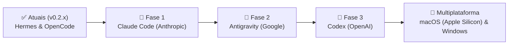

# NexoBench — Roteiro de Expansão de Harnesses (Roadmap)

A arquitetura do NexoBench foi construída especificamente para expandir o ecossistema de agentes autônomos sem criar caminhos duplicados na interface do usuário. Todos os novos motores aderem à abstração central `HarnessAdapter`.

---

## 🎯 Princípios Inegociáveis para Novos Harnesses

1. **Sem Simulação por Prompt:** Nenhum agente será adicionado através de um mero prompt de sistema personificando o modelo. É exigido o uso do binário ou serviço oficial do agente.
2. **Executável Instalado pelo Usuário:** O usuário é dono de suas configurações e credenciais, mantidas nas ferramentas oficiais.
3. **Serviços Locais Restritos ao Loopback:** Toda comunicação IPC ou de rede local ocorre exclusivamente em `127.0.0.1` ou sockets Unix locais.
4. **Leitura Segura:** Leitura de bancos de histórico existentes exclusivamente em modo somente leitura (*read-only*).
5. **Critério de Admissão:** Um novo harness só é liberado para o usuário após validação dos quatro pilares:
   - Gerenciamento e retomada de sessão;
   - Portão de permissões de ferramentas em tempo real;
   - Interrupção confiável de execução (*cancel*);
   - Auditoria transparente de custos e tokens consumidos.

---

## 🗺️ Fases do Roteiro

### 1. Claude Code (Anthropic)
- **Status:** Em desenvolvimento / Análise de protocolo.
- **Integração:** Conexão com o CLI oficial do Claude Code via stream bidirecional de eventos.
- **Recursos Chave:** Rastreamento de raciocínio estendido (*extended thinking*), suporte a ferramentas MCP (Model Context Protocol) e aprovação visual de comandos bash sugeridos pelo Claude.

### 2. Antigravity (Google)
- **Status:** Planejado.
- **Integração:** Integração com o agente e assistente de desenvolvimento do Google DeepMind / Antigravity.
- **Recursos Chave:** Suporte a contexto multimodal massivo (1M+ tokens), streaming de subagentes paralelos e sincronização com skills de engenharia.

### 3. Codex (OpenAI)
- **Status:** Planejado.
- **Integração:** Suporte aos agentes e modelos especializados em engenharia de código da OpenAI.
- **Recursos Chave:** Otimização para geração e refatoração de código com baixa latência e integração com ecossistema de ferramentas OpenAI.

### 4. Expansão Multiplataforma
- **Linux:** Pacotes `.deb` e `AppImage` consolidados (atualmente em produção).
- **macOS:** Suporte planejado para empacotamento universal (`arm64` Apple Silicon e `x64` Intel) com arquivos `.dmg`.
- **Windows:** Suporte planejado para distribuição `.exe` (NSIS) e pacote MSIX.

---

*O futuro do desenvolvimento unificado de software assistido por agentes de inteligência artificial.*

